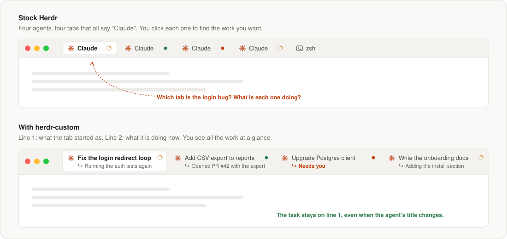
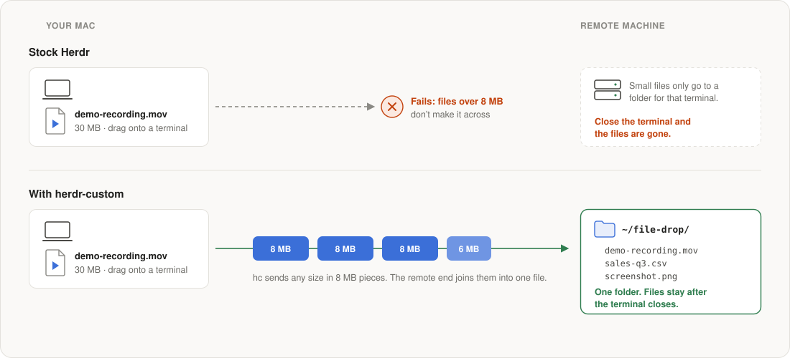

# herdr-custom

**Two upgrades to [Herdr](https://github.com/herdrdev) for people who run many
AI agents and remote terminals at the same time.**

- **Tabs that tell you what each agent is doing.** No more row of tabs that
  all say "Claude".
- **Drop files of any size on a remote terminal.** Drag a 30 MB file from your
  Mac onto a terminal on a server, and it arrives. The files stay in one folder.

Both are small add-ons on top of the official Herdr releases (a mod and one
patch), not a fork. You can go back to stock Herdr with two commands.



## At a glance

|  | Stock Herdr | With herdr-custom |
|---|---|---|
| Tab label | The program name: "Claude", "Claude", "Claude" | The task, then what the agent does now |
| Find the agent you want | Click each tab | Read the tab bar |
| Drop a file on a remote terminal | Files up to 8 MB | Files of any size |
| Where dropped files go | A folder for each terminal, deleted with it | One folder that you choose, kept |

## 1. Tabs that tell you what each agent is doing

When you run five Claude Code agents, stock Herdr shows five tabs with the
same name. To find the agent that fixes the login bug, you must click through
them.

With herdr-custom, each tab has two short lines:

```
✳ Fix the login redirect loop        ← line 1: the task it started on
  ↳ Running the auth tests again     ← line 2: what it does now
```

- **Line 1 does not move.** It keeps the first useful title of the session,
  so the task stays the same even when the agent changes its window title.
  A name that you give the tab always comes first.
- **Line 2 follows the work.** It shows the agent's latest progress report.
  For a shell, it shows the command that runs. When the agent stops, the last
  report stays, or you see "Needs you" or "Waiting for your reply".
- **Short.** Each line has 8 words or fewer.
- **No new setup for agents.** The data comes from Herdr. You do not add a
  Claude Code hook. To set a line from a script, use a label:
  `hc label <terminal> started="…"` or `now="…"`.

**Why it helps:** you see all your work in one look. You know which agent is
done, which one is busy, and which one waits for you, without clicking.

## 2. Drop files of any size on a remote terminal

Herdr lets you drag a file from your Mac onto a terminal that runs on another
machine. In stock Herdr, files over 8 MB fail, and the file goes to a hidden
folder that Herdr deletes when the terminal closes.



With herdr-custom:

- **Any size.** `hc` sends the file in 8 MB pieces, and the remote end joins
  them into one file. Screen recordings, data exports and logs all work.
- **One folder that keeps your files.** Set `drop_dir` on the remote machine,
  in `~/.config/herdr-core/config.toml`. Use a full path:

  ```toml
  drop_dir = "/home/you/file-drop"
  ```

  Every dropped file goes there, and it stays after the terminal closes.
  Without `drop_dir`, Herdr uses its usual folder for each terminal.

**Why it helps:** you can give an agent on a server the real file, for example
a screen recording of a bug or a full CSV export, by drag and drop. You do not
need `scp`, and you can find the file again later.

> Both machines need the patched `hc`: the sender cuts the file into pieces,
> and the receiver joins them. If only one end has it, files over 8 MB stop
> with an "update hc" message.

## Install

You need Herdr Desktop 0.1.15 or later on a Mac. To build `hc`, you need
Rust 1.95 and Zig 0.16.

```sh
git clone https://github.com/bath/herdr-custom && cd herdr-custom

app/install.sh        # Tabs: install the mod and layout in Herdr Desktop (Mac)
core/build.sh         # File drop: build hc with the patch (prints the binary path)
core/install-mac.sh   # File drop on a Mac
```

On each Linux machine that you connect to, build there and install:

```sh
core/build.sh
hc update --from <path that build.sh printed>
```

Each part works alone. Install only the tabs, or only the file drop, if you
want.

## Go back to stock Herdr

```sh
herdr-app do layout.switch '{"name":"main"}'   # stock tabs
hc update --force                              # official hc
```

## How it stays on top of Herdr

|  | Tabs (`app/`) | File drop (`core/`) |
|---|---|---|
| Part of Herdr | Herdr Desktop (`herdr-app`) | herdr-core (`hc`) |
| Kind of change | A user mod and a layout. No change to Herdr's source. | One patch on a named upstream commit |
| After a Herdr update | The mod stays as it is. To get Herdr's new tab features, clone the new `tabs` mod and add the change again. | Run `core/build.sh <new commit>` to put the patch on the new release |

Details for each part: [app/README.md](app/README.md) and
[core/README.md](core/README.md).

## Files

```
app/
  mods/titled-tabs/   the two-line tab bar (a copy of Herdr's built-in tabs mod)
  layouts/titled.json Herdr's main layout, with the new tab bar
  install.sh
core/
  patches/            the file drop patch for herdr-core
  UPSTREAM            the upstream commit the patch applies to
  build.sh            clone upstream, apply the patch, build
  install-mac.sh      install the built hc on a Mac
docs/img/             the pictures in this README
```

## License

Apache License 2.0, the same as Herdr. `app/mods/titled-tabs` is a changed copy
of Herdr's built-in `tabs` mod, and `core/patches` changes
[herdr-core](https://github.com/herdrdev/herdr-core). Both are by the Herdr
authors, under Apache-2.0.
